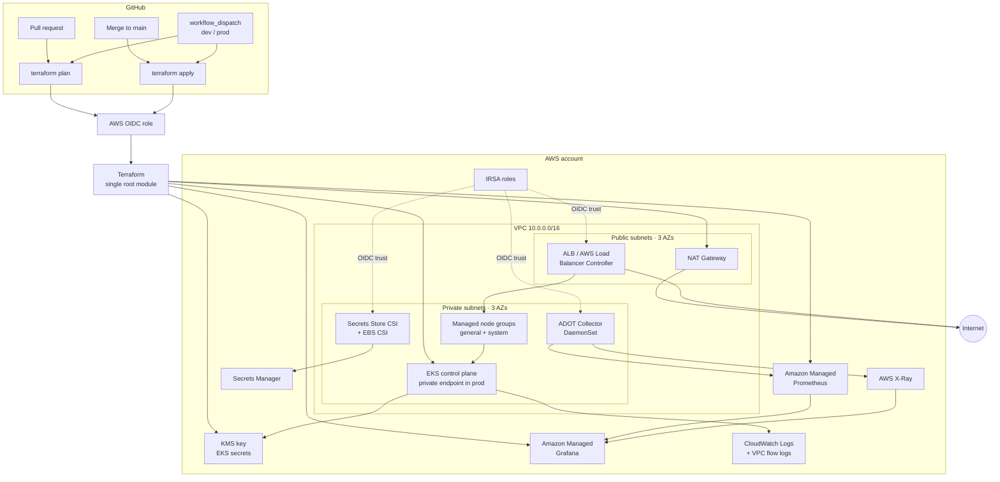

# 🚀 Production-Pattern AWS EKS Platform (Terraform)

A reusable, multi-environment AWS EKS platform built with Terraform. One root module and five reusable modules manage `dev` and `prod` through environment-specific `.tfvars` and `.tfbackend` files, following the **“single codebase, multiple environments”** pattern.

> **Project status:** production-pattern reference implementation, validated end-to-end in a single AWS `dev` account. This is **not** a claim of full production readiness. See [Known limitations](#known-limitations) and the phased [portfolio roadmap](docs/portfolio-roadmap.md).

## 🏗️ Architecture



See [docs/architecture.md](docs/architecture.md) for trust boundaries, request flow, and environment differences.

## 🎯 What this demonstrates

- **Terraform ownership:** reusable modules, environment separation, input validation, outputs, remote state, and native S3 locking.
- **AWS platform design:** VPC layout, private subnets, NAT strategy, EKS, IAM, KMS, IRSA, Secrets Manager, and managed observability.
- **Security engineering:** least-privilege trust policies, no static AWS keys, private API endpoint, encrypted state, and scoped secret access.
- **Delivery engineering:** GitHub Actions OIDC, PR plans, environment-gated applies, pinned chart versions, and reproducible bootstrap.
- **Operational debugging:** a documented EBS CSI crash-loop investigation with root cause, fix, and PVC-level verification.
- **Tradeoff analysis:** decision records for module ownership, IRSA, managed observability, and Terraform-managed Helm.

See [docs/decisions](docs/decisions/) for the architecture decision records.

## 🛠️ Tech Stack

- **Infrastructure as Code:** Terraform 1.10+
- **Cloud:** AWS VPC, EKS, IAM, KMS, Secrets Manager, S3
- **Kubernetes add-ons:** AWS Load Balancer Controller, EBS CSI, Secrets Store CSI + AWS provider, Cluster Autoscaler, Metrics Server, ADOT Collector
- **Observability:** Amazon Managed Prometheus (AMP), Amazon Managed Grafana (AMG), AWS X-Ray, CloudWatch
- **CI/CD:** GitHub Actions with AWS OIDC — no long-lived AWS keys

## ✨ Key Features

- **Multi-environment by design:** one root module; `dev` and `prod` differ only in variables and backend keys.
- **Security first:**
  - IRSA for every workload that needs AWS access, including the VPC CNI, ALB controller, EBS CSI, Secrets Store CSI, Cluster Autoscaler, and ADOT.
  - Customer-managed KMS key for EKS secret encryption, namespaced per cluster.
  - Private EKS endpoint by default in prod.
  - EKS access entries (`API_AND_CONFIG_MAP`) instead of hand-editing `aws-auth`.
  - Encrypted, versioned, public-access-blocked Terraform state bucket with native S3 locking.
- **Production networking:** three AZs, private worker subnets, one NAT per AZ in prod, VPC flow logs to CloudWatch.
- **Observability built in:** ADOT scrapes annotated pods and node kubelets, remote-writes to AMP over SigV4, and exports OTLP traces to X-Ray. Grafana can query AMP, CloudWatch, and X-Ray.
- **Safe delivery:** plan on every PR, apply on merge to `main`, and a manual prod workflow gated by a GitHub Environment approval.
- **Operational guardrails:** node-group capacity validation, cluster name length validation, KMS alias isolation, and ignore-on-desired-size for Cluster Autoscaler.

## 📣 Portfolio evidence

| Evidence | Status |
| --- | --- |
| Architecture diagram, trust boundaries, and ADRs | ✅ In repository |
| Terraform `fmt` and `validate` | ✅ Verified |
| Terraform `plan` clean | ✅ No changes |
| Live EKS cluster and healthy EBS CSI controller | ✅ Verified in `dev` |
| PVC bind, mount, write, and cleanup test | ✅ Reproducible via [scripts/smoke-test-ebs.sh](scripts/smoke-test-ebs.sh) |
| EBS CSI incident root cause and fix | ✅ Documented below |
| Secrets Store CSI provider | ✅ Running with `sts.amazonaws.com` and `pods.eks.amazonaws.com` token audiences |
| Static analysis and Terraform tests | ✅ TFLint 0 warnings, 3 tests, Gitleaks clean, Trivy 0 high/critical (3 documented exceptions) |
| GitHub OIDC provider and roles | ✅ `dev` and `prod` roles created; dev role has EKS admin access |
| GitHub Actions plan/apply run | ⏳ Pending GitHub environment secrets and a workflow rerun |
| ALB-hosted demo application screenshot | ⏳ Phase 4 |
| AMP, X-Ray, or Grafana screenshot | ⏳ Phase 4 |
| Before/after incident evidence | ⏳ Phase 4 |

This table is deliberately honest: planned evidence is marked as pending rather than presented as completed. The [portfolio roadmap](docs/portfolio-roadmap.md) defines the gate for each remaining item.

## 📂 Project Structure

```text
terraform-eks/
├── main.tf                  # Root module — orchestrates VPC, EKS, IAM, add-ons
├── variables.tf             # Input variables + validations
├── outputs.tf               # Cluster, networking, KMS, and observability outputs
├── providers.tf             # AWS, Kubernetes, and Helm providers
├── versions.tf              # Terraform/provider constraints + S3 backend
├── .tflint.hcl              # TFLint configuration
├── .trivyignore             # Documented IaC scan exceptions
├── makefile                 # init / plan / apply / validate / kubeconfig
├── bootstrap/               # State bucket + GitHub OIDC provider/roles
│   ├── github_oidc.tf
│   └── terraform.tfvars.example
├── scripts/
│   ├── smoke-test-ebs.sh    # Disposable EBS CSI PVC smoke test
│   └── check-no-secrets.sh  # Local Gitleaks/grep secret scan
├── tests/
│   └── vpc.tftest.hcl       # Terraform tests + negative validation cases
├── k8s-manifests/           # Example app, ingress, SecretProviderClass, PDB
├── docs/
│   ├── architecture.md
│   ├── github-oidc.md
│   ├── portfolio-roadmap.md
│   └── decisions/
│       ├── 0001-custom-modules.md
│       ├── 0002-irsa-vs-pod-identity.md
│       ├── 0003-managed-observability.md
│       └── 0004-terraform-helm-vs-gitops.md
├── modules/
│   ├── vpc/                 # Subnets, NAT, flow logs, route tables
│   ├── eks/                 # Cluster, node groups, core add-ons, IRSA for CNI
│   ├── iam/                 # IRSA roles for add-ons
│   ├── addons/              # Helm releases + AMP/AMG
│   └── security/            # KMS key and alias
├── vars/
│   ├── dev.tfvars.example
│   └── prod.tfvars.example
├── backend/
│   ├── dev.tfbackend.example
│   └── prod.tfbackend.example
└── .github/workflows/
    └── terraform.yml        # OIDC plan/apply pipeline
```

## 🚦 Getting Started

### Prerequisites

- Terraform 1.10 or later
- AWS CLI credentials with permissions to create VPC, EKS, IAM, KMS, S3, CloudWatch, AMP, and Grafana resources
- An AWS region and a globally unique S3 bucket name for state
- `kubectl` and Helm for cluster access

### 1. Create the state bucket

```sh
cp bootstrap/terraform.tfvars.example bootstrap/terraform.tfvars
# Edit bootstrap/terraform.tfvars and set a globally unique bucket_name.
make bootstrap
```

The bootstrap configuration uses local state by design because the S3 bucket does not exist yet. Keep `bootstrap/terraform.tfstate` safe and backed up.

Optional: set `log_bucket_name` in `bootstrap/terraform.tfvars` to create a separate access-log bucket. S3 server access logging cannot target the source bucket.

Optional GitHub OIDC: set `github_repository` and `github_environments` in `bootstrap/terraform.tfvars`. Bootstrap then creates the GitHub OIDC provider and one role per environment. Read the role ARNs with:

```sh
terraform -chdir=bootstrap output -json github_oidc_role_arns
```

Put the matching ARN in the GitHub environment secret `AWS_ROLE_ARN`. See [docs/github-oidc.md](docs/github-oidc.md).

### 2. Configure an environment

```sh
cp vars/dev.tfvars.example vars/dev.tfvars
cp backend/dev.tfbackend.example backend/dev.tfbackend
```

Set the real bucket name in `backend/dev.tfbackend`, then review `vars/dev.tfvars`:

- `cluster_version` must be an EKS-supported version in your region.
- `admin_role_arn` should be a real IAM role/user ARN. In prod it is required.
- `additional_admin_role_arns` grants extra admins, such as the GitHub Actions OIDC role, access to the EKS API.
- `enable_public_endpoint` and `public_access_cidrs` control EKS API exposure.
- `cluster_endpoint_access_cidrs` adds VPN/Transit Gateway ranges allowed to reach the private endpoint.
- `secrets_manager_secret_arns` can be narrowed from `["*"]` to your secret ARNs.
- `node_groups` supports labels, taints, Spot/On-Demand, and a dedicated system group.

For production, use the `prod` examples. Real `.tfvars` and `.tfbackend` files are git-ignored; never commit credentials or sensitive values.

### 3. Initialize and deploy

```sh
make init ENV=dev
make fmt
make validate
make plan ENV=dev
make apply ENV=dev
```

The Makefile defaults to `dev`; pass `ENV=prod` for production:

```sh
make init ENV=prod
make plan ENV=prod
make apply ENV=prod
```

Run `make destroy ENV=prod` only when you intend to tear down that environment. Staging is not configured in this repository.

### 4. Access the cluster

```sh
make kubeconfig ENV=dev
kubectl get nodes
kubectl get pods -A
```

### 5. Smoke-test persistent storage

```sh
make smoke-test-ebs
```

This creates a temporary namespace, a 1 GiB `gp3` PVC, and a BusyBox pod; waits for the PVC to bind and the pod to become ready; writes and reads data through the mounted volume; then deletes the namespace and waits for the EBS volume finalizer to finish.

To keep the namespace for screenshots or debugging:

```sh
KEEP_SMOKE_TEST=1 make smoke-test-ebs
kubectl -n <namespace> get pvc,pod
kubectl delete namespace <namespace>
```

The script is in [`scripts/smoke-test-ebs.sh`](scripts/smoke-test-ebs.sh) and does not change Terraform state.

## 🔁 CI/CD

The workflow in [`.github/workflows/terraform.yml`](.github/workflows/terraform.yml) runs:

- **Pull request:** `terraform fmt -check`, `validate`, and `plan` for `dev`.
- **Push to `main`:** `terraform apply` for `dev`.
- **Manual dispatch:** choose `dev` or `prod` and `plan` or `apply`. The `prod` GitHub Environment can require reviewers.

The bootstrap layer creates the OIDC provider and environment-scoped roles when `github_repository` is set. The role must also be listed in `additional_admin_role_arns` in `TF_VARS` so Terraform can authenticate to Kubernetes. Configure the GitHub environment variables and secrets as described in [docs/github-oidc.md](docs/github-oidc.md).

> **CI quality gates:** the workflow runs format, TFLint, `terraform test`, Gitleaks, and Trivy before plan/apply. Trivy exceptions are documented in [`.trivyignore`](.trivyignore). Gitleaks requires a free `GITLEAKS_LICENSE` secret for organization-owned repositories; personal repositories do not need one.

> **Private endpoint note:** production uses a private EKS endpoint. GitHub-hosted runners cannot reach it. Use a self-hosted runner in the VPC and set the repository-level `TF_RUNNER_LABEL` variable to its label, or temporarily restrict `public_access_cidrs` to a known egress range.

## ✅ Quality gates

Run the local gates after `make init ENV=dev`:

```sh
make fmt-check
make validate
make lint
make test
make secrets-check   # uses Gitleaks if installed, otherwise a grep fallback
make scan            # requires Trivy on PATH
```

| Gate | What it checks |
| --- | --- |
| `terraform fmt -check` | HCL formatting |
| `terraform validate` | Provider/module schema and references |
| `tflint` | Terraform rules and module version/provider constraints |
| `terraform test` | Valid VPC plan and negative AZ/CIDR validation cases with mock providers |
| `gitleaks` | Secrets in the working tree and git history |
| `trivy config` | IaC misconfigurations at HIGH/CRITICAL severity |

The three Trivy exceptions are intentional and documented in [`.trivyignore`](.trivyignore): EKS control-plane egress, SSE-S3 on the state bucket, and public IP assignment on the intentionally public ALB/NAT subnet tier.

The Secrets Store CSI `CSIDriver` is configured with both `sts.amazonaws.com` and `pods.eks.amazonaws.com` token audiences; the AWS provider logs an explicit warning when the second audience is missing.

## 📈 Observability

- **Metrics:** ADOT discovers pods with `prometheus.io/scrape: "true"` and node kubelets; writes to AMP with SigV4.
- **Traces:** applications send OTLP to the ADOT Collector (`adot-collector.adot-collector.svc:4317`), which exports to X-Ray.
- **Dashboards:** AMG is provisioned with a customer-managed role that can query AMP, CloudWatch, and X-Ray.
- **Logs:** EKS control-plane logs and VPC flow logs go to CloudWatch.

AMG uses `AWS_SSO`; IAM Identity Center must be enabled in the account/region.

## 🔐 Security Notes

- The EKS cluster role has scoped KMS and CloudWatch Logs permissions; it does not use broad managed policies for those services.
- The VPC CNI runs with IRSA, keeping CNI permissions off the node role.
- The Secrets Store CSI AWS provider has its own IRSA role; the CSI driver itself has no AWS permissions.
- EKS secrets are encrypted with a customer-managed KMS key. The alias includes the cluster name so environments can share an account.
- The state bucket enforces TLS, encrypts objects, blocks public access, enables versioning, and uses native S3 locking (`use_lockfile = true`).
- The example manifests use a non-root image, read-only root filesystem, dropped capabilities, PDB, and topology spread.

## ⚙️ Environment Differences

| Setting | dev | prod |
| --- | --- | --- |
| VPC CIDR | `10.0.0.0/16` | `10.1.0.0/16` |
| NAT | single | one per AZ |
| EKS public endpoint | enabled | disabled by default |
| Nodes | Spot `t3.medium` | On-demand `m6i.large` + system group |
| KMS deletion window | 7 days | 30 days |
| Apply | on merge | manual approval + VPC runner |

## 🧯 Incident case study: EBS CSI attacher crash-loop

This was a real failure in the `dev` cluster, not a theoretical example.

**Symptom**

The EBS CSI controller pod was `4/5` with `csi-attacher` in `CrashLoopBackOff`. The container restarted 26 times and exited with code 2.

**Evidence**

```text
flag provided but not defined: -feature-gates
Usage of /csi-attacher:
  ...
```

The deployment was using EBS CSI chart `2.35.0` with `external-attacher:v4.7.0`.

**Root cause**

The chart adds `--feature-gates=VolumeAttributesClass=true` whenever the cluster exposes the `storage.k8s.io/v1beta1/VolumeAttributesClass` API. Kubernetes 1.36 exposes that API, but `external-attacher:v4.7.0` does not implement `--feature-gates` at all. The sidecar exited before it could start.

**Fix**

Upgraded the EBS CSI chart to `2.62.0`, which ships `external-attacher:v4.12.0` and supports the feature-gate flag. The chart version is pinned in `modules/addons/variables.tf` to avoid regression.

**Verification**

- Controller: `5/5` containers ready, zero restarts.
- Node driver: `3/3` containers ready.
- `csi-attacher` logs show driver probing, leader election, and controller startup.
- A temporary `gp3` PVC bound, mounted into a pod, accepted a write, and was cleaned up.

**Guardrail**

The version pin and the troubleshooting entry exist specifically because this class of chart/Kubernetes API drift is easy to reintroduce. See [troubleshooting section](#troubleshooting).

## Known limitations

This is a portfolio reference implementation, not a finished production platform.

- **Single AWS account:** `dev` and `prod` can live in one account; real production should use separate accounts with AWS Organizations guardrails.
- **Prod is not deployed:** the production variables, private endpoint, and VPC-runner path are documented and planned but not verified end-to-end.
- **No disaster recovery:** there is no cross-region state replication, cluster restore procedure, or persistent-data backup runbook.
- **No GitOps:** Helm releases are applied by Terraform. Argo CD/Flux would provide continuous reconciliation and cleaner promotion.
- **No OPA/admission policy-as-code yet:** TFLint, Trivy, Gitleaks, and `terraform test` are present, but Kubernetes admission policy and OPA/Conftest are not.
- **Observability is not fully evidenced:** the AMP/AMG/ADOT path is plan-tested; the current `dev` variables have observability disabled, and AMG requires IAM Identity Center.
- **No cost guardrails:** no AWS Budgets, alerts, or Infracost check is committed.
- **No SLOs or runbooks:** alert routing, error budgets, and on-call procedures are out of scope for the MVP.
- **Custom modules have a maintenance cost:** see [ADR 0001](docs/decisions/0001-custom-modules.md).
- **Secrets policy defaults to wildcard:** `secrets_manager_secret_arns` defaults to `["*"]`; production should narrow it.

## 💸 Cost profile

These are order-of-magnitude estimates for `us-east-1`, excluding data transfer, taxes, support, and promotional credits. Verify with the AWS Pricing Calculator or Infracost before leaving anything running.

| Environment | Main drivers | Rough monthly |
| --- | --- | --- |
| `dev` | EKS control plane, one `t3.medium`, one NAT, ALB, 50 GB gp3, CloudWatch/KMS | ~$150–$250 |
| `prod` | EKS control plane, three `m6i.large` + system nodes, three NATs, ALB, AMP/AMG, logs | ~$600–$1,200+ |

Cost controls to add before a public demo:

- AWS Budgets with alerts.
- `make destroy ENV=dev` after recording evidence.
- Infracost on pull requests.
- Keep observability disabled until it is needed for screenshots.

## 🗺️ Roadmap

The phased plan and verification gates are in [docs/portfolio-roadmap.md](docs/portfolio-roadmap.md).

1. **Phase 1 (complete):** portfolio narrative, ADRs, limitations, and cost profile.
2. **Phase 2 (complete):** `scripts/smoke-test-ebs.sh` and `make smoke-test-ebs`.
3. **Phase 3 (complete, commit `14f3b14`):** `tflint`, Trivy, Gitleaks, and `terraform test` gates. CI environment-scoping fix pending.
4. **Phase 4:** CI, cluster, ingress, and observability evidence.
5. **Phase 5:** production-readiness backlog: multi-account, DR, GitOps, cost, and SLOs.

## Troubleshooting

- **`terraform init` cannot find the backend bucket:** run `make bootstrap` first and verify `bucket_name` in `bootstrap/terraform.tfvars`.
- **`terraform plan` cannot authenticate to Kubernetes:** set `admin_role_arn` to a valid IAM role/user ARN, not an STS assumed-role session ARN. The principal Terraform runs as must be this ARN (or otherwise have cluster admin) so the Helm/Kubernetes providers can authenticate.
- **Helm releases time out:** check that the EKS endpoint is reachable from where Terraform runs. Prod is private by default.
- **`configure-aws-credentials` says `Input required and not supplied: aws-region`:** set the `AWS_REGION` environment variable on the GitHub environment (the workflow defaults to `us-east-1`), or set `TF_STATE_BUCKET`/`AWS_ROLE_ARN`/`TF_VARS` if the preflight step names them.
- **GitHub Actions OIDC returns `AccessDenied` / `Not authorized to perform sts:AssumeRoleWithWebIdentity`:** verify `AWS_ROLE_ARN` matches the environment role. Newer GitHub subjects include immutable IDs (`repo:owner@id/repo@id:environment:dev`), so the trust policy must use `StringLike` with both the legacy and immutable forms; see [docs/github-oidc.md](docs/github-oidc.md).
- **GitHub OIDC works but Kubernetes authentication fails:** add the GitHub role ARN to `additional_admin_role_arns` in the environment `TF_VARS` and apply the EKS access entry.
- **AMG creation fails:** enable IAM Identity Center or change the authentication provider before applying.
- **Cluster Autoscaler does not scale:** verify the node-group tags and that `cluster_autoscaler_image_tag` (default `v<cluster_version>.0`) matches an image tag for the cluster minor version.
- **ADOT cannot write to AMP:** confirm the IRSA role is attached to `adot-collector/adot-collector` and the endpoint is HTTPS.
- **EBS CSI `csi-attacher` crash-loops with `flag provided but not defined: -feature-gates`:** the pinned EBS CSI chart is too old for the cluster's `VolumeAttributesClass` API. Keep `ebs_csi_version` at `2.62.0` or newer for Kubernetes 1.33+.

## 🧹 Cleanup

```sh
make destroy ENV=dev
```

The bootstrap bucket has `prevent_destroy = true`. To remove it, manually update the bootstrap configuration and state only after you are certain no state files are needed.
