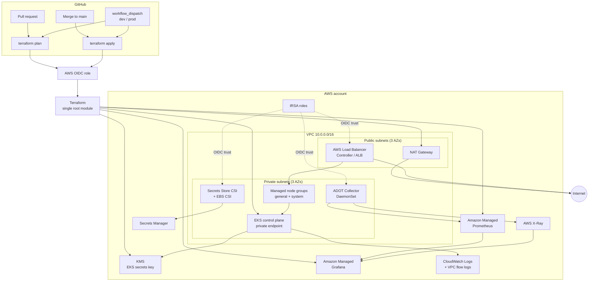

# Architecture

## Diagram

## Components

| Layer | Implementation |
| --- | --- |
| Network | VPC with three public and three private subnets, one NAT in dev and one per AZ in prod, VPC flow logs |
| Control plane | EKS with private endpoint by default in prod, all control-plane log types, KMS-encrypted secrets |
| Compute | Managed node groups defined as a map, optional Spot in dev, AL2023 AMI, IRSA-only node permissions |
| Access | EKS access entries with `API_AND_CONFIG_MAP`; optional admin principal; no legacy `aws-auth` editing |
| Ingress | AWS Load Balancer Controller with IRSA and a 2/3-replica HA deployment |
| Storage | EBS CSI driver with IRSA and an encrypted gp3 default StorageClass |
| Secrets | Secrets Store CSI driver + AWS provider, IRSA scoped to the provider service account |
| Autoscaling | Cluster Autoscaler with IRSA, ASG discovery tags, and Metrics Server |
| Metrics | ADOT Collector scrapes annotated pods and node kubelets, remote-writes to AMP with SigV4 |
| Traces | ADOT Collector receives OTLP and exports to X-Ray |
| Dashboards | Amazon Managed Grafana with AMP, CloudWatch, and X-Ray data sources |
| Delivery | GitHub Actions OIDC, plan on PR, apply on merge, manual prod apply with environment approval |

## Request path

1. A client reaches the ALB created by the AWS Load Balancer Controller.
2. The ALB targets pod IPs in private subnets (`target-type: ip`).
3. Pods pull configuration/secrets through the Secrets Store CSI provider and IRSA; no static AWS keys are stored in Kubernetes.
4. Pods expose `/metrics` and optionally annotate themselves with `prometheus.io/scrape: "true"`.
5. The ADOT DaemonSet scrapes metrics and receives OTLP traces, then sends metrics to AMP and traces to X-Ray.
6. Grafana queries AMP, CloudWatch, and X-Ray through a customer-managed IAM role.

## Trust boundaries

- **AWS API:** only the Terraform execution role and the cluster creator/admin principal can mutate the cluster.
- **Kubernetes API:** the EKS endpoint is private in production; CI must run from a connected network.
- **Pod AWS access:** each add-on has its own IRSA role and a narrowly scoped trust policy on `system:serviceaccount:<namespace>:<name>`.
- **Data at rest:** EKS secrets use a customer-managed KMS key; S3 state is versioned, encrypted, and public-access-blocked.
- **Data in transit:** TLS is enforced on the state bucket and ALB listeners should use ACM certificates in production.

## Environment layout

Each environment is a separate Terraform state and a separate set of resources:

| Setting | dev | prod |
| --- | --- | --- |
| VPC CIDR | `10.0.0.0/16` | `10.1.0.0/16` |
| NAT | single | one per AZ |
| Public EKS endpoint | enabled (restrict CIDRs) | disabled by default |
| Nodes | Spot `t3.medium` | On-demand `m6i.large` + system group |
| Flow logs | enabled | enabled |
| KMS deletion window | 7 days | 30 days |
| Apply | on merge | manual approval |

Keep the two environments in separate AWS accounts when possible; at minimum, use separate state keys, roles, and KMS aliases (the KMS alias is namespaced by cluster name).
